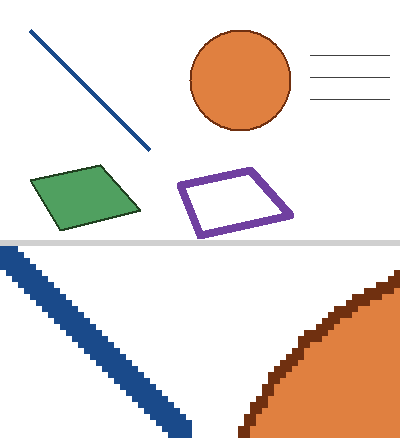
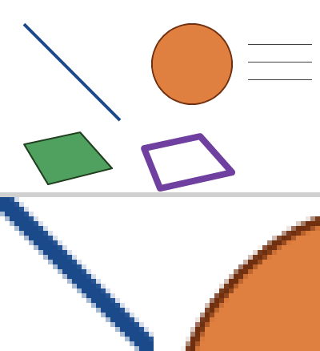
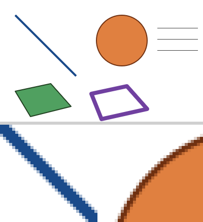

# tkd2dcanvas

在 Windows 上实现的 Canvas（面向 Tcl/Tk 与 Python tkinter）。

> 提供**两个渲染后端**，编译进同一个 DLL，用 `-renderer` 选项选择：
>
> | 后端 | 抗锯齿来源 | 说明 |
> | --- | --- | --- |
> | `d2d`（默认） | Direct2D 自带 | `PER_PRIMITIVE` 解析覆盖率，边缘最平滑 |
> | `gdi` | 本仓库自己的超采样引擎 | 不用 Direct2D 画图元，边缘由超采样算 |
>
> 两个后端都在同一个 `tkd2dcanvas01.dll` 里。`d2d` 运行时依赖 Windows 7 SP1+ 自带的 `d2d1.dll` / `dwrite.dll`，无需捆绑。详见 [docs/gdi_antialias.md](docs/gdi_antialias.md)。
>
> 当前状态：0.1.0。**M0–M10 已完成**：Tcl package 可加载， `tkd2dcanvas .c -width 400 -height 300` 能创建真实 Tk widget； item 命令（create/coords/move/tag/bind/scroll…）、图像与文字、window item 均已实现。详见 [docs/roadmap.md](docs/roadmap.md)。

## Python 侧最终目标

```python
from tkd2dcanvas import Canvas

canvas = Canvas(root, width=800, height=600)
canvas.pack(fill="both", expand=True)
canvas.create_rectangle(20, 20, 200, 120, fill="tomato", outline="navy")
```

底层实际发生的是：

```text
root.tk.call("tkd2dcanvas", pathName, ...)
root.tk.call(pathName, "create", "rectangle", ...)
```

## 两个渲染后端

两个后端在**同一个 DLL**（`tkd2dcanvas01.dll`）里，靠 `-renderer` 选项在 **创建时**选择走哪条渲染路径 —— 不需要单独的构建产物。

### Python

```python
from tkd2dcanvas import Canvas

# 默认：Direct2D
canvas = Canvas(root, width=800, height=600)

# 纯 GDI：抗锯齿由本仓库的超采样引擎算
canvas = Canvas(root, width=800, height=600, renderer="gdi")
```

### Tcl

```tcl
# 默认：Direct2D
tkd2dcanvas .c -width 800 -height 600

# 纯 GDI
tkd2dcanvas .c -width 800 -height 600 -renderer gdi
```

| 选项 | 默认值 | 说明 |
| --- | --- | --- |
| `-renderer` | `d2d` | `d2d`（Direct2D/DirectWrite）或 `gdi`（纯 GDI + 手动抗锯齿）；非法值会报错 |
| `-antialiasfactor` | `4` | 仅 `gdi` 后端有效：超采样倍数 N（2…8）。越大边缘越平滑、越慢 |

`-renderer` **只能在创建时指定**：渲染器在控件附着到窗口时创建，之后改这个选项不会切换后端（要换请新建控件）。

### 怎么选

| | `d2d` | `gdi` |
| --- | --- | --- |
| 边缘质量 | 解析覆盖率（256 级灰阶） | 超采样量化（4 倍 = 17 级灰阶），斜边有轻微台阶 |
| 文字 | DirectWrite ClearType | GDI `ExtTextOutW` ClearType，排版细节与 D2D 不同 |
| 画图元用什么 | Direct2D | 只有 GDI（`gdi32`）+ 自己的超采样引擎 |
| 适合 | 常规 UI | 不想用 Direct2D 画图元、或要排查 D2D 自身问题时 |

两个后端共用同一套场景图、item 语义、脏矩形重绘和滚动路径 —— 差别只在 "怎么把像素画出来"。

### 看图

同一个场景，三种画法。**上面是 1:1 的完整画面，下面是同一块区域的放大**（左边 45° 斜边，右边圆弧）：

| 原生 Tk 画布 | GDI（手动抗锯齿） | Direct2D |
| --- | --- | --- |
|  |  |  |
| 边缘是硬阶梯（放大后能数出台阶） | 边缘是连续的灰度过渡 | 边缘是连续的灰度过渡，与 GDI 基本一致 |

> 原生 Tk 画布（`tkinter.Canvas`）在 Windows 上也是用 GDI 画的，
> 而 GDI **本身没有抗锯齿** —— 所以斜边和圆弧都是一级级的台阶。
> `gdi` 后端把这个能力自己补上了；`d2d` 后端直接用 Direct2D 的
> `PER_PRIMITIVE`，覆盖率是解析算出来的（256 级灰阶），
> 比 4 倍超采样（17 级）更细腻。

### 实测

200 个 24×24 椭圆、600×400 画布：

| 场景 | `d2d` | `gdi` |
| --- | --- | --- |
| 滚动一帧 | 1.54 ms | 0.10 ms |
| 整屏重绘 | 1.31 ms | 0.15 ms |

滚动时两个后端都是**移位**（后备缓冲 BitBlt），保留区不重新渲染。细节、限制与取舍见 [docs/gdi_antialias.md](docs/gdi_antialias.md)。

## 目录结构

| 目录 | 作用 | 依赖 |
| --- | --- | --- |
| `native/core` | Canvas 场景图、几何、tag、命中测试 | 无外部依赖 |
| `native/items` | 各类 item（Rect/Oval/Line/...） | `core` |
| `native/render` | Renderer 抽象与 Direct2D/GDI 两个实现 | core、d2d1/dwrite、gdi32 |
| `native/platform_win` | Win32 窗口、WM_PAINT、DPI、双缓冲 | Win32 |
| `native/tk_glue` | Tcl/Tk widget 胶水层 | Tcl/Tk |
| `tcl/` | Tcl package 安装文件（pkgIndex.tcl） | Tcl |
| `python/tkd2dcanvas` | Python API、loader、兼容层 | Python/tkinter |
| `tests/` | C++ / Tcl / Python 测试 | — |
| `tools/` | 环境检查、打包辅助脚本 | Python |
| `third_party/tcltk-sdk` | 可选的 Tcl/Tk 开发文件 | 见 `third_party/tcltk-sdk/README.md` |

构建与安装见 [docs/building.md](docs/building.md)，架构说明见 [docs/architecture.md](docs/architecture.md)，渲染性能基准见 [docs/performance.md](docs/performance.md)。

## 许可

本项目以 **LGPL-3.0-or-later** 发布：

- [LICENSE](LICENSE)
- [COPYING](COPYING)

动态链接到 Tcl/Tk stub，运行时不静态链接任何第三方库。构建产物中若捆绑 Tcl/Tk，Tcl/Tk 依其自身 BSD 许可，需保留其许可证声明。
